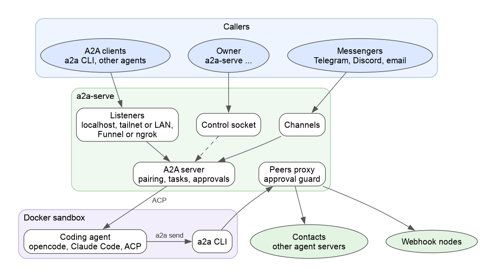

# A2A Serve

<p align="center">
  <a href="./LICENSE"></a>
</p>

<div align="center">
   
   <h3>
       One command turns the coding agent in your project into a sandboxed <a href="https://a2a-protocol.org">A2A</a> agent that people, scripts and other agents can call.
   </h3>
</div>

> [!WARNING]
> A2A Serve is pre-1.0. Commands, flags and `config.yaml` keys may change; stored state always migrates forward ([upgrades](./docs/upgrades.md)). Read the [security page](./docs/concepts/security.md) and the [known limitations](#-known-limitations) before you expose an agent to other people.

---

```bash
cd ~/src/app
a2a-serve start opencode --secret OPENROUTER_API_KEY --private tailscale --detach
a2a-serve channel add telegram --token env:BOT_TOKEN
```

This starts opencode in a Docker sandbox with the project mounted, gives it an HTTPS address on your tailnet, and connects a Telegram bot. Open the link it prints to link the chat to you. Edits and shell commands wait for your approval there.

Send it work from a terminal, or invite someone else:

```bash
a2a send -a "$(a2a-serve status --url=local)" "What does this project do?"
a2a-serve pair invite anna   # prints a one-time code for anna
```

## ✨ Features

- **Any ACP agent:** opencode, Claude Code, or your own with `a2a-serve start acp --command`.
- **Sandbox and approvals:** the agent runs in Docker, and its edits and commands wait for your approval.
- **Reachable anywhere:** your tailnet, an Agent Mesh relay, a public URL, Telegram, Discord or email, with access by one-time pairing codes.
- **Agents calling agents:** the agent delegates to other agents through the server, which keeps their tokens outside the sandbox.

<div align="center">
  <picture>
    <source media="(prefers-color-scheme: dark)" srcset="./docs/graphs/readme-overview-dark.png">
    
  </picture>
</div>

## 🚀 Getting Started

```bash
brew install a2aproject/a2a-cli/a2a-serve    # macOS and Linux
a2a-serve doctor --fix                       # set up the a2a CLI and check Docker
```

[Getting started](./docs/getting-started.md) has the install script and walks through a first agent.

## 📚 Documentation

The documentation site is <https://a2aproject.github.io/a2a-serve/>.

- **[Getting started](./docs/getting-started.md):** install a2a-serve and talk to your first agent.
- **[User guide](./docs/guide.md):** settings, sandbox, approvals, networks, messengers, agents calling agents, schedules and backups.
- **Concepts:** the [architecture](./docs/concepts/architecture.md), the [access model](./docs/concepts/access-model.md), [Agent Mesh](./docs/concepts/agent-mesh.md) and [security](./docs/concepts/security.md).
- **[Examples](./examples/):** step-by-step lessons, from [a local agent](./examples/01-agent-server/) to [Tailscale, Telegram and a Grok bot](./examples/02-tailscale-telegram-grok/) and an [Agent Mesh relay](./examples/03-agentmesh-relay/).
- **[Reference](./docs/reference/commands/a2a-serve.md):** every command and flag, the [configuration file](./docs/reference/configuration.md), [exit codes](./docs/reference/output.md) and [HTTP routes](./docs/reference/http-routes.md).

## 🚧 Known Limitations

- **API keys are readable inside the sandbox.** Values passed with `--secret` are environment variables of the agent, so a tricked agent can read them and send them anywhere ([#16](https://github.com/a2aproject/a2a-serve/issues/16)).
- **The sandbox can reach any host.** A tricked agent can send the files it can read anywhere ([#17](https://github.com/a2aproject/a2a-serve/issues/17)).
- **A cloned repository can configure the agent you start in it.** `a2a-serve start` takes the command, image, mounts, environment variables and MCP servers from the project's `.a2a/config.yaml` and `.mcp.json`. Read both before you start an agent in a repository you didn't write.
- **Agent images follow the latest agent releases** at the time they were published, so the same tag can carry different agent versions over time.

## 🤝 Contributing

Open an issue or pull request to share suggestions, questions, or edge cases. See the **[Contributing guide](CONTRIBUTING.md)**.

## 📄 License

A2A Serve is licensed under the [Apache License 2.0](LICENSE).
