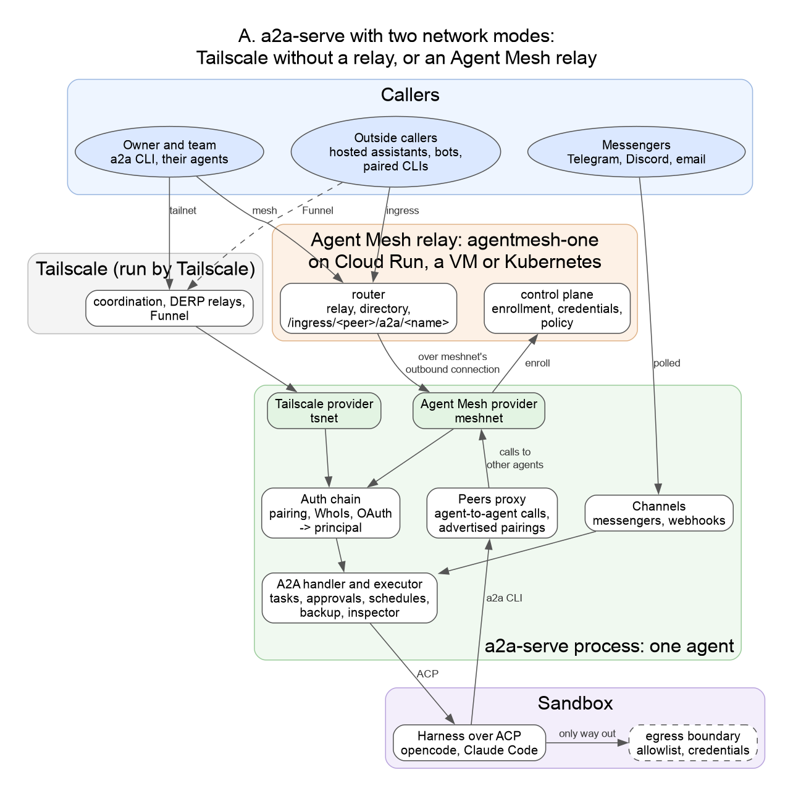
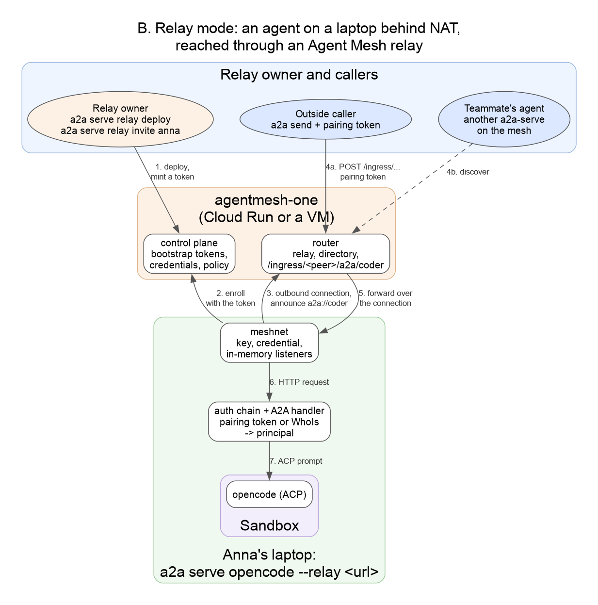
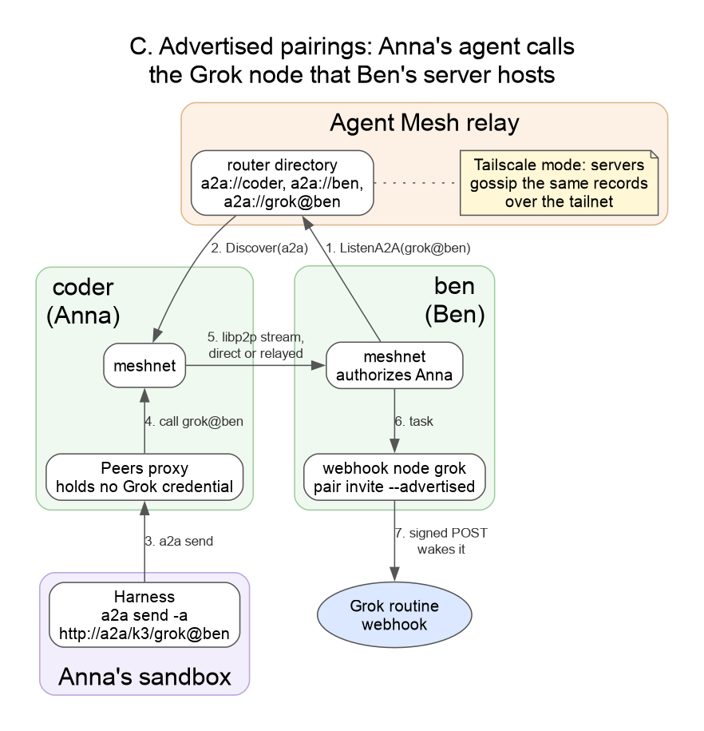

# a2a-serve and Agent Mesh

> [!NOTE]
> Proposal, November 2026. Nothing here is implemented yet.

[Agent Mesh](https://github.com/google/agentmesh) gives agents a private
network: nodes enroll with a control plane, connect through routers that relay
traffic for machines behind NAT, find each other in a directory, and can be
reached from outside through router ingress. a2a-serve turns a coding agent
into an A2A agent, with a sandbox, approvals, pairing and messengers.

The proposal: a2a-serve keeps the agent runtime and everything users see.
Agent Mesh becomes the relay backbone for teams. Tailscale stays as the mode
with no relay to run.

## Who does what

| | a2a-serve | Agent Mesh | Tailscale |
|---|---|---|---|
| Harness over ACP, sandbox, approvals | ✓ | | |
| Pairing, messengers, schedules, backup, inspector | ✓ | | |
| Network seam (`network.Provider`) | ✓ | | |
| Member in the a2a-serve process | | `meshnet` | tsnet |
| Hub: enrollment, credentials, policy | | control plane | coordination server |
| Relay for agents behind NAT | | router | DERP |
| Public URL | | router ingress | Funnel |
| Directory of agents | | router directory | tailnet peers |
| Who runs the hub | | the team (`a2a serve relay`) | Tailscale |

## A. Components



The seam is `network.Provider` (`internal/network/network.go:67`). It already
separates the private listener from the public one, so each can use a
different provider: `--private lan --public ngrok` works today. The Agent Mesh
provider is built on `meshnet`, the embedded Go SDK proposed in
[google/agentmesh#843](https://github.com/google/agentmesh/pull/843), which
is modeled on tsnet:

| `network.Provider` | `meshnet` |
|---|---|
| `ListenPrivate` | `ListenA2A` → `PrivateListener`, `PrivateURL` |
| `ListenPublic` | `PublicListener`, `PublicURL` (router ingress) |
| `WhoIs` | `Server.WhoIs` → `CallerInfo`: peer, principal, roles |
| `Peers` | `Server.Discover`, `a2a` services |
| `HTTPClient` | `Server.HTTPClient`, for calls to other agents |

Everything above the providers works the same in both modes. The sandbox gets
its only route out through an egress boundary in the server, following
[agents.net](https://github.com/aojea/agents.net). That boundary doesn't
depend on the network mode.

## Two modes

| | Tailscale (no relay) | Relay (Agent Mesh) |
|---|---|---|
| For | one person or one tailnet | teams and outside callers |
| Infrastructure | none; Tailscale hosts the hub | agentmesh-one on Cloud Run, a VM or Kubernetes |
| Start | `a2a serve run opencode --private tailscale` | `a2a serve run opencode --relay <url>` |
| Public URL | Funnel, after tailnet policy setup | router ingress, per agent |
| Private network callers | trusted by tailnet identity (`WhoIs`) | trusted by mesh identity (`WhoIs`) |
| Public URL callers | pairing tokens, Google sign-in | the same; the relay forwards requests unchanged |
| Advertised pairings | gossip between servers over the tailnet | directory, one `a2a://` service per pairing |
| Shared MCP, keyless inference, team egress | not available | `mcp://`, `inference://`, `egress://` |

`--private tailscale --public <relay-url>` also fits the design: private
traffic over the tailnet, and a public URL from the relay.

## B. Relay mode



```sh
a2a serve relay deploy --cloud-run --project my-proj   # 1. the relay owner
a2a serve relay invite anna                            #    a bootstrap token
a2a serve run opencode --relay https://relay.example.com --relay-token env:RELAY_TOKEN   # Anna
```

1. The relay is agentmesh-one at the version this a2a-serve pins. a2a-serve
   writes its policy from a2a-serve settings, so users never edit policy JSON.
2. `meshnet` enrolls with the bootstrap token and gets a short-lived
   credential bound to its own key.
3. It keeps one outbound connection to the router and announces `a2a://coder`.
4. An outside caller sends to `<relay>/ingress/<peer>/a2a/coder` with its
   pairing token (4a). A teammate's agent finds `coder` in the directory and
   connects directly when NAT allows it, otherwise through the router (4b).
5. The router forwards the request over Anna's outbound connection. In
   `passthrough` mode it hands the `Authorization` header over unchanged
   ([google/agentmesh#838](https://github.com/google/agentmesh/pull/838)).
6. `meshnet` delivers it as an ordinary HTTP request. The auth chain checks the
   pairing token, or takes the caller's mesh identity from `WhoIs`.
7. The executor sends the prompt to the harness over ACP.

agentmesh-one isn't tied to Cloud Run. It's one binary with SQLite in a data
directory, and router traffic runs over WebSocket on its HTTPS port. On Cloud
Run it runs as a single instance and needs Postgres, because the filesystem is
wiped on every new revision. A VM with a disk needs neither, and can add QUIC
with `--p2p-listen`. `--tunnel cloudflare` runs it on a laptop for demos, but
the URL changes on every restart.

## C. Advertised pairings



A pairing created with `--advertised` becomes visible to every agent on the
private network. The hosting server keeps the credential, and every call goes
through it:

1. Ben's server publishes its Grok node as `a2a://grok@ben` with `ListenA2A`.
   This needs the embedded `meshnet`: the sidecar node has no API to add
   services at runtime.
2. Anna's server finds it with `Discover`.
3. Anna's harness calls it like any other agent:
   `a2a send -a http://a2a/k3/grok@ben`.
4. Anna's peers proxy makes the call through `meshnet`.
5. Ben's server checks Anna's mesh identity against its own rules.
6. The task goes to the webhook node.
7. Ben's server wakes the Grok routine with a signed POST.

In Tailscale mode, steps 1 and 2 are gossip: servers exchange versioned
advertisement records with their tailnet peers until every server has them.

## Auth

- **Private network.** The network provider identifies the caller: `WhoIs` on
  the tailnet, or on the mesh. Mesh labels map to a2a-serve roles, the way the
  Tailscale capability `a2aproject.org/cap/a2a` does today.
- **Public URL.** a2a-serve's auth layer checks pairing tokens and Google
  sign-in. It sits above the network providers, so it works the same on
  Funnel, ngrok, the relay or your own domain. The relay runs ingress in
  `passthrough` mode and leaves auth to a2a-serve.
- **Google sign-in.** The agent acts as its own OAuth authorization server and
  issues tokens that work only at that agent. A request without a token gets a
  `401`, and a2a-cli signs the user in and retries. The owner can register
  their own Google app; without one, a2a-cli signs in with a shared A2A app
  and ties the sign-in to the agent's URL.

## Steps

1. **Prototype.** An `agentmesh-node` sidecar (`type: a2a`,
   `ingress.auth_mode: passthrough`) in front of `a2a serve`, on a local
   agentmesh-one. Check pairing and `a2a send` through the ingress URL.
2. **Agent Mesh provider and `a2a serve relay`.** `meshnet` behind a build tag,
   bootstrap tokens, the public URL used everywhere a2a-serve prints or embeds
   one.
3. **Advertised pairings** through the directory, and OAuth through `edge`
   ingress.
4. **Team services:** egress, shared MCP and inference over the mesh.

## Open questions for Agent Mesh

1. **Hybrid ingress auth.** A mode that verifies a Biscuit or OIDC token when
   present and otherwise forwards `Authorization`, so OAuth users and pairing
   tokens can share one URL.
2. **`meshnet` as its own Go module.** Embedding it today pulls libp2p, envoy
   and biscuit-go into every a2a-serve build.
3. **An exported hub package.** agentmesh-one lives under `internal/`, so
   `a2a serve relay` can only run the binary or image.
4. **A custom dialer for `meshnet`.** It would let `meshnet` run over tsnet,
   putting a relay inside a tailnet.
5. **Version compatibility** between `meshnet` and agentmesh-one before 1.0.
6. **Stable ingress names.** Today pairing commands carry 52-character peer
   IDs.

## Diagrams

The sources are Graphviz files in [`graphs/`](graphs/). After editing one,
re-render it:

```sh
cd docs/graphs && dot -Tpng -Gdpi=110 agentmesh-<name>.dot -o agentmesh-<name>.png
```
