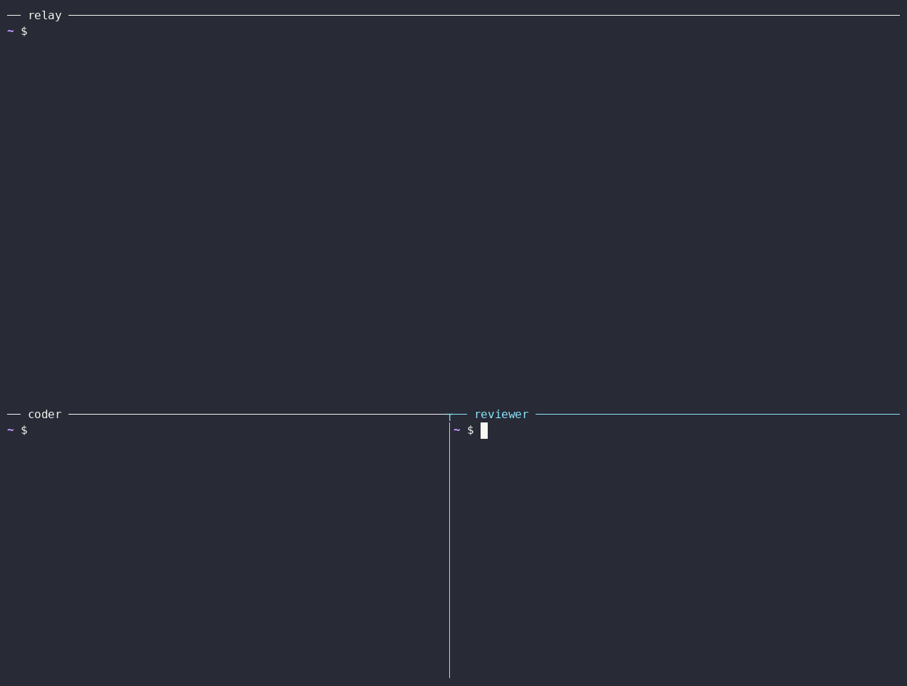

# Relay on Cloud Run

This guide runs a [relay](relays.md) on Google Cloud Run, with its data in Cloud SQL for PostgreSQL and its secrets in Secret Manager.



Cloud Run gives the relay an HTTPS address that doesn't change, so it needs no reverse proxy or tunnel. The service runs the published image `ghcr.io/a2aproject/a2a-serve-relay` as one instance. You manage the relay from your machine with its URL and admin token.

## Before you start

You need a Google Cloud project with billing, the `gcloud` CLI signed in to it, and a2a-serve on your machine. Set the project, the region and the a2a-serve release to run. Each release publishes the image with its version tag:

```bash
export CLOUDSDK_CORE_PROJECT=my-project
REGION=us-central1
VERSION=v0.1.0
gcloud services enable run.googleapis.com sqladmin.googleapis.com secretmanager.googleapis.com
```

A Cloud Run service URL is known before the service exists. The relay uses it as its address:

```bash
URL="https://a2a-serve-relay-$(gcloud projects describe "$CLOUDSDK_CORE_PROJECT" --format='value(projectNumber)').$REGION.run.app"
```

## Create the database

The relay keeps its members, invites and bans in PostgreSQL, so they outlive the container. `db-f1-micro` is the smallest tier:

```bash
gcloud sql instances create a2a-serve-relay-db --region "$REGION" \
  --database-version POSTGRES_17 --edition enterprise --tier db-f1-micro
gcloud sql databases create relay --instance a2a-serve-relay-db
DB_PASSWORD=$(openssl rand -hex 24)
gcloud sql users create relay --instance a2a-serve-relay-db --password "$DB_PASSWORD"
DB_INSTANCE=$(gcloud sql instances describe a2a-serve-relay-db --format='value(connectionName)')
```

Cloud SQL takes a daily backup of the instance by default.

## Store the secrets

The relay reads its admin token and database DSN from environment variables, which Cloud Run fills from Secret Manager. Store each value without a trailing newline:

```bash
printf %s "$(openssl rand -hex 32)" | gcloud secrets create relay-admin-token --data-file=-
printf 'host=/cloudsql/%s user=relay password=%s dbname=relay sslmode=disable' "$DB_INSTANCE" "$DB_PASSWORD" |
  gcloud secrets create relay-database --data-file=-
```

The relay's sign-in keys derive from its admin token. Every container that gets the same token keeps the agents that signed in. A new token signs everyone out.

## Let people sign in

Skip this section for a relay that admits only invited agents.

Register the relay's Google app as [Relays](relays.md#let-people-sign-in) describes, with `$URL/a2a-serve/signin/callback` as the redirect URI. Then store its client secret:

```bash
printf %s "$GOOGLE_CLIENT_SECRET" | gcloud secrets create relay-google-client-secret --data-file=-
```

## Create a service account

The relay runs as its own service account, which may connect to Cloud SQL and read the relay's secrets:

```bash
gcloud iam service-accounts create a2a-serve-relay
SA="a2a-serve-relay@$CLOUDSDK_CORE_PROJECT.iam.gserviceaccount.com"
gcloud projects add-iam-policy-binding "$CLOUDSDK_CORE_PROJECT" \
  --member "serviceAccount:$SA" --role roles/cloudsql.client --condition None --format none
for s in relay-admin-token relay-database relay-google-client-secret; do
  gcloud secrets add-iam-policy-binding "$s" --member "serviceAccount:$SA" \
    --role roles/secretmanager.secretAccessor --format none
done
```

Leave out `relay-google-client-secret` when people don't sign in. The grants can take a minute to apply. If the deploy below fails with `Permission denied on secret`, run it again.

## Deploy the relay

```bash
gcloud run deploy a2a-serve-relay --region "$REGION" \
  --image "ghcr.io/a2aproject/a2a-serve-relay:$VERSION" \
  --service-account "$SA" --allow-unauthenticated \
  --min-instances 1 --max-instances 1 --no-cpu-throttling \
  --concurrency 1000 --timeout 3600 \
  --add-cloudsql-instances "$DB_INSTANCE" \
  --set-secrets RELAY_ADMIN_TOKEN=relay-admin-token:latest,RELAY_DATABASE=relay-database:latest,GOOGLE_CLIENT_SECRET=relay-google-client-secret:latest \
  --args="--listen=:8080,--url=$URL,--admin-token=env:RELAY_ADMIN_TOKEN,--database=env:RELAY_DATABASE,--allow-email=*@example.com,--google-client-id=<id>,--google-client-secret=env:GOOGLE_CLIENT_SECRET"
```

For a relay that admits only invited agents, leave out `GOOGLE_CLIENT_SECRET` and the last three arguments. Write `--args=` with an equals sign, since its value starts with `--`. `--args` splits on commas, so give `--allow-email` once per entry. [`relay run`](../reference/commands/relay.md#a2a-serve-relay-run) lists every argument.

Each Cloud Run flag has a reason:

| Flag | Why |
|---|---|
| `--allow-unauthenticated` | Agents and their callers reach the relay from anywhere. The relay checks every request itself. |
| `--min-instances 1 --max-instances 1` | Agent Mesh keeps the relay's routing state in one process. Two instances would form two meshes behind one URL. |
| `--no-cpu-throttling` | The relay renews leases and syncs keys between requests. |
| `--concurrency 1000` | Each agent holds a WebSocket connection to the relay, and Cloud Run counts it as a request. The default of 80 would cap the relay at 80 agents. |
| `--timeout 3600` | Cloud Run closes a WebSocket connection at the request timeout, and agents connect again. One hour is the longest timeout. |

An organization policy that restricts sharing to your domain refuses `--allow-unauthenticated`. With such a policy, deploy with `--no-invoker-iam-check`.

## Check the relay

The relay reports its versions and whether people may sign in:

```bash
curl -s "$URL/.well-known/a2a-serve-relay"
```

Manage the relay from your machine with its URL and admin token:

```bash
export RELAY_ADMIN_TOKEN=$(gcloud secrets versions access latest --secret relay-admin-token)
a2a-serve relay status --url "$URL" --admin-token env:RELAY_ADMIN_TOKEN
a2a-serve relay invite ci-bot --url "$URL" --admin-token env:RELAY_ADMIN_TOKEN
a2a-serve relay members --url "$URL" --admin-token env:RELAY_ADMIN_TOKEN
```

The relay's log shows why it stopped or refused to start:

```bash
gcloud run services logs read a2a-serve-relay --region "$REGION"
```

Agents join the relay at its URL, as [Relays](relays.md#let-people-sign-in) shows.

## Change settings

Deploy the new arguments with `gcloud run services update a2a-serve-relay --region "$REGION" --args=...`. Give every argument again, since `--args` replaces the list. The new revision starts the relay with the new settings and applies a changed `--allow-email` to the agents already on it.

Cloud Run starts a new instance for each revision and moves new requests to it. The previous instance keeps the agents connected to it until their connections reach `--timeout`. Until then, agents on the two instances don't see each other. A shorter timeout ends this sooner, and agents reconnect more often in return. An agent that restarts connects to the new instance at once.

## Upgrade the relay

Each a2a-serve release pins one Agent Mesh version. A newer Agent Mesh migrates the relay's database, and an older one can't use it again. So back up the database before you deploy a newer release:

```bash
gcloud sql backups create --instance a2a-serve-relay-db
gcloud run services update a2a-serve-relay --region "$REGION" \
  --image "ghcr.io/a2aproject/a2a-serve-relay:$NEW_VERSION"
```

The previous instance keeps running on the migrated database until its connections close, as [Change settings](#change-settings) explains.

A relay on a machine refuses to start with an older Agent Mesh than the one that last used its data. It records that version in its relay directory, which a container loses when it stops. So on Cloud Run, deploy only the same or a newer release. To go back to an older release, restore the backup taken before the upgrade, and then deploy the older image:

```bash
gcloud sql backups list --instance a2a-serve-relay-db
gcloud sql backups restore <backup-id> --restore-instance a2a-serve-relay-db
gcloud run services update a2a-serve-relay --region "$REGION" \
  --image "ghcr.io/a2aproject/a2a-serve-relay:$VERSION"
```

The restore brings back the members, invites and bans of the backup's time. Agents that joined after the backup have to join again.
