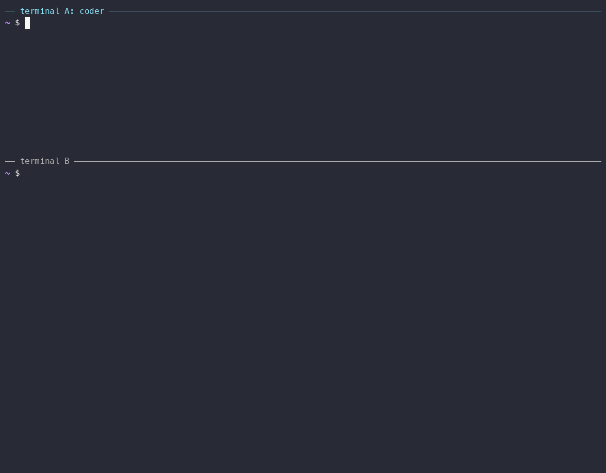

# Serve a Coding Agent

This example serves a coding agent, opencode or Claude Code, from its project
directory and talks to it like any other A2A agent.



## What you'll learn

- How to start a coding agent as an A2A server, and where it keeps its state
- How you get a token for it, and how pairing gives one to others
- How the agent asks before a tool call, and how you approve it
- How one agent calls another

## Prerequisites

- The `a2a` CLI and `a2a-serve` installed (see [Getting Started](../../docs/getting-started.md#install)).
- Docker. Without it, add `--sandbox local` to the start commands below; the
  agent then runs on your machine and needs to be installed there.
- An API key for the model, such as `OPENROUTER_API_KEY`, exported in your shell.

## 1. Create a workspace

The agent works in its project directory. Make a small one, with a hint that
keeps the answers short:

```bash
mkdir -p ~/a2a-example1/coder && cd ~/a2a-example1/coder
cat > AGENTS.md <<'EOF'
You are reached over A2A. Keep answers to one short sentence.
EOF
```

## 2. Start the agent

In **terminal A**, from the workspace:

```bash
a2a-serve start opencode --name coder --secret OPENROUTER_API_KEY
```

For Claude Code, use `a2a-serve start claude` instead.

The first run saves the flags to `.a2a/config.yaml` and the key to
`.a2a/state/secrets`, pulls or builds the agent image, and stays in the
foreground. Later runs from this directory are just `a2a-serve start`.

In **terminal B**, check that it runs and note its local URL:

```bash
cd ~/a2a-example1/coder
a2a-serve status
```

```
coder (opencode) running for 12s, pid 41233
  dir      /home/you/a2a-example1/coder
  local    http://127.0.0.1:46757
```

## 3. Call it from this machine

Every A2A request needs a token. On start, the server saves an owner token
for its local URL, and the `a2a` CLI attaches it through the credential helper
that `a2a-serve doctor --fix` set up during install.

Other people and machines need an invitation: `a2a-serve pair invite <name>`
prints a one-time code, which they redeem with
`a2a-serve pair join <agent-url> <code>`. Step 7 does the same for another
agent.

Save the agent's URL so the commands below stay short, and give the agent
time to think:

```bash
cat > .env <<EOF
A2ACLI_AGENT_CARD=$(a2a-serve status --url=local)
A2ACLI_TIMEOUT=3m
EOF
```

## 4. Ask a question

```bash
a2a send "In one sentence, what can you do?"
```

## 5. Approve a tool call

Ask for something that runs a command:

```bash
a2a send "Use bash to write the output of 'uname -sr' into system.txt."
```

The agent asks first, so the task stops in `input-required`. The output shows
the tool call, the options (`once`, `always`, `reject`) and how to resume:

```
Resume:     a2a send --task-id <task-id> "<reply>"
```

Approve it on the same task:

```bash
a2a send --task-id <task-id> approve
```

The agent runs the command and finishes. `system.txt` is now in the workspace.

## 6. Continue the conversation

The context ID from the previous answer keeps the conversation going:

```bash
a2a send --context-id <context-id> "Which file did you just create?"
```

## 7. Let it call another agent (optional)

In **terminal B**, start a second agent in the background. Then let `coder`
call it: mint a code on the reviewer's side and redeem it as a contact on
coder's side.

```bash
mkdir -p ~/a2a-example1/reviewer && cd ~/a2a-example1/reviewer
a2a-serve start opencode --name reviewer --secret OPENROUTER_API_KEY --detach
a2a-serve status                  # note reviewer's local URL
a2a-serve pair invite coder       # prints a code

cd ~/a2a-example1/coder
a2a-serve contact add reviewer --url <reviewer-url> --code <code>
```

Now ask coder to delegate:

```bash
a2a send "Ask the reviewer agent what files it sees in its workspace, and tell me."
```

Coder runs `a2a send -a http://a2a/<handle>/reviewer ...` in its sandbox. Its
server makes the call with the token it just stored, so no credential enters
the sandbox. If reviewer needs an approval, your task waits for it and shows
reviewer's request. Answer it like coder's own:

```bash
a2a send --task-id <task-id> approve
```

The task then continues with reviewer's result.

## 8. Clean up

```bash
cd ~/a2a-example1/coder
a2a-serve pair rm "$(a2a-serve status --url=local)"   # the owner token of this machine
a2a-serve stop
cd ~/a2a-example1/reviewer && a2a-serve stop
```

Everything an agent keeps is in `.a2a/` in its workspace; delete the
directories to start over.

## Next steps

[Tailscale, Telegram and a Grok Bot](../02-tailscale-telegram-grok/README.md) puts the agent on your tailnet and
in Telegram, and adds a Grok bot as a webhook node. The
[user guide](../../docs/index.md#user-guide) covers the rest, and the
[architecture](../../docs/advanced/architecture.md) explains how the
pieces fit together.
