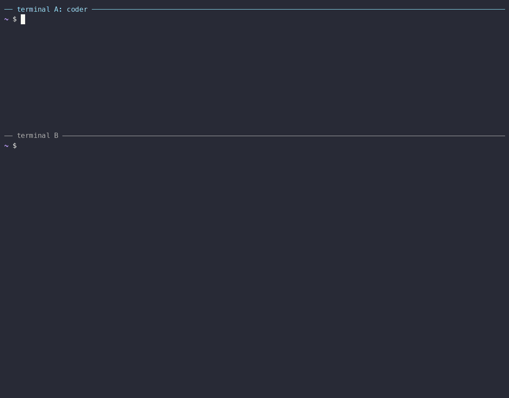

# Tailscale, Telegram and a Grok Bot

[Serve a Coding Agent](../01-agent-server/README.md) served a coding agent on localhost. This one makes it a personal
agent you can reach from anywhere: on your tailnet, from a Telegram chat, and
with a public URL so a Grok bot can work for it as a webhook node.



## What you'll learn

- How the agent joins your tailnet, where your devices need no pairing
- How to give it a public HTTPS URL with Tailscale Funnel
- How to talk to it, and approve its tool calls, from Telegram
- How to host a Grok bot as a webhook node the agent can delegate to
- How to keep it running as a service

## Prerequisites

- The setup of [Serve a Coding Agent](../01-agent-server/README.md#prerequisites): the `a2a` CLI, `a2a-serve`, Docker, and an API key such as
  `OPENROUTER_API_KEY` exported in your shell.
- A [Tailscale](https://tailscale.com) account, with the machine you work
  from on the tailnet.
- A Telegram account.
- A Grok bot that can be triggered by an HTTP webhook. You need its webhook
  URL, and the token it expects if it checks one.

## 1. Prepare the tailnet

The agent serves HTTPS on your tailnet, and Funnel publishes the same URL on
the internet. Both need a one-time change in the Tailscale admin console:

1. On the **DNS** page, enable **HTTPS certificates**.
2. On the **Access controls** page, open the policy file in the JSON editor
   and allow Funnel. `nodeAttrs` is a top-level key, next to `acls` or
   `grants`:

   ```json
   {
     "acls": [ ... ],
     "nodeAttrs": [
       { "target": ["autogroup:member"], "attr": ["funnel"] }
     ]
   }
   ```

   If the policy already has a `nodeAttrs` list, add the entry to it. Then
   save the policy.

## 2. Create a Telegram bot

In Telegram, talk to [@BotFather](https://t.me/BotFather): send `/newbot`,
choose a name and a username, and copy the token it gives you. Each agent
needs its own bot.

```bash
export CODER_BOT_TOKEN=<token from BotFather>
```

## 3. Start the agent

From the agent's project directory:

```bash
mkdir -p ~/a2a-example2/coder && cd ~/a2a-example2/coder
a2a-serve config set --agent opencode --name coder --secret OPENROUTER_API_KEY \
  --model openrouter/~google/gemini-flash-latest --private tailscale --public tailscale
a2a-serve messenger add telegram --token env:CODER_BOT_TOKEN
a2a-serve start
```

`config set --agent` creates the agent without starting it, and
`messenger add` connects the bot. Later runs don't need `CODER_BOT_TOKEN`.

On the first run, the agent asks to join your tailnet:

```
tailscale: open https://login.tailscale.com/a/... to add "coder" to your tailnet
```

Open the link and approve the machine. In the admin console, **disable key
expiry** for it, or the agent drops off the tailnet when the key expires. On
a headless machine, pass `--tailscale-authkey env:TS_AUTHKEY` to `config set`.

Then it prints its URLs and the Telegram bot:

```
✓ local    http://127.0.0.1:46757
✓ private  https://coder.your-tailnet.ts.net
✓ public   https://coder.your-tailnet.ts.net
✓ telegram @coder_agent_bot
→ link yourself as owner: https://t.me/coder_agent_bot?start=K7Q29XF4   (15 min)
```

## 4. Link Telegram

Open the `t.me` link on your phone and press **Start**. The bot replies:

```
Linked as owner. Write to talk to coder.
```

Now write to it like to any chat. `/new` starts a fresh conversation and
`/stop` cancels the running task. When the agent wants to run something, you
get the request with buttons to allow it once, always allow it or deny it.
See [Messengers](../../docs/guide/messengers.md) for the chat commands.

Try: `Create a file notes.md with three ideas for a weekend project.`

## 5. Call it from your other machines

Your devices on the tailnet are recognized by their Tailscale identity, so
they need no pairing code:

```bash
a2a send -a https://coder.your-tailnet.ts.net "What's in notes.md?"
```

Other people on your tailnet can call it too. `a2a-serve status` lists who can
call, and `a2a-serve config set --private-allow-incoming paired` limits the
tailnet to you and your pairings. See [Networks](../../docs/guide/networks.md).

## 6. Add the Grok bot as a webhook node

A webhook node is an agent that only runs when woken: the server sends a
signed wake to the webhook when a task arrives. See
[Webhook nodes](../../docs/guide/webhook-nodes.md).

In the agent's directory, add the node:

```bash
export GROK_WEBHOOK_TOKEN=<token your Grok webhook expects>
a2a-serve pair invite grok \
  --webhook <your Grok bot's webhook URL> \
  --webhook-header "Authorization: Bearer env:GROK_WEBHOOK_TOKEN" \
  --description "Grok: web search and current events"
```

```
→ webhook node grok; the agent calls it as "grok"
  send this to the agent behind the webhook (the code works once, for 15 min):

    You are the webhook node "grok" of the agent at https://coder.your-tailnet.ts.net.
    Read https://coder.your-tailnet.ts.net/mailbox/skill.md and follow it.
    Your pairing code is 8HD2-PQ7M.

  you can call it yourself at https://coder.your-tailnet.ts.net/n/grok
```

## 7. Set up the Grok side

Paste the message from step 6 into your Grok bot's instructions. The skill it
points to tells the bot how to install the tools, pair with the code, read a
wake and reply. You don't run any pairing command yourself. The server's
binaries run for the bot when the server runs on Linux. Otherwise the bot can
use the plain HTTPS API at the end of the skill.

On its first run, the bot pairs and gets a node token. Store that token where
the bot keeps secrets, as `A2A_NODE_TOKEN`. The bot answers a wake with:

```bash
a2a-serve mailbox reply <taskId> --final "Here is what I found: ..."
```

The same token lets the bot call your agent, as a member, for example from a
scheduled routine:

```bash
a2a send -a https://coder.your-tailnet.ts.net "Summarize today's commits"
```

Check that the node is paired:

```bash
a2a-serve pair list
```

The `grok` row says `not paired` until the bot has redeemed its code. If the
code expired, run `a2a-serve pair invite grok` again for a new one.

## 8. Delegate to Grok from Telegram

In the Telegram chat:

```
Ask grok what the top AI news is today, and summarize it in three bullets.
```

The agent calls `grok`, the bot replies later, and the agent summarizes the
result in your chat.

From a machine on your tailnet, you can also call the node directly as its
owner:

```bash
a2a send -a https://coder.your-tailnet.ts.net/n/grok "What's new with Tailscale?"
```

## 9. Keep it running

Stop the foreground process with Ctrl-C, then install the agent as a user
service (systemd on Linux, launchd on macOS):

```bash
a2a-serve start --service
a2a-serve status
a2a-serve logs -f
```

`a2a-serve stop --uninstall` removes the service again.

## Troubleshooting

| Symptom | What to check |
| --- | --- |
| `HTTPS certificates are disabled in this tailnet` | Step 1: enable HTTPS on the DNS page. |
| No `public` URL | The `funnel` attribute in the tailnet policy (step 1). |
| The URL is `coder-1.your-tailnet.ts.net` | Another machine is named `coder`. Remove it in the admin console, and rename this one to `coder`. |
| The URL doesn't resolve | On the tailnet, the calling machine must run Tailscale with MagicDNS. From the internet, a new Funnel name can take several minutes to appear. |
| `! tailscale: getting the certificate` | HTTPS certificates on the DNS page (step 1). |
| The bot never answers | `a2a-serve logs`: a wake that failed shows the webhook's status, such as `webhook returned 401` for a wrong token. `a2a-serve pair list` shows whether the node is paired. |
| The node lost its token | `a2a-serve pair invite grok` issues a new code; pairing replaces the old token. |
| Telegram is silent | Only one process can use a bot token. Stop any other process that uses it. |

## Next steps

The user guide covers [Discord and email](../../docs/guide/messengers.md),
[who answers approvals](../../docs/guide/approvals.md), and
[contacts between agents](../../docs/guide/agent2agent.md) on the same tailnet.
