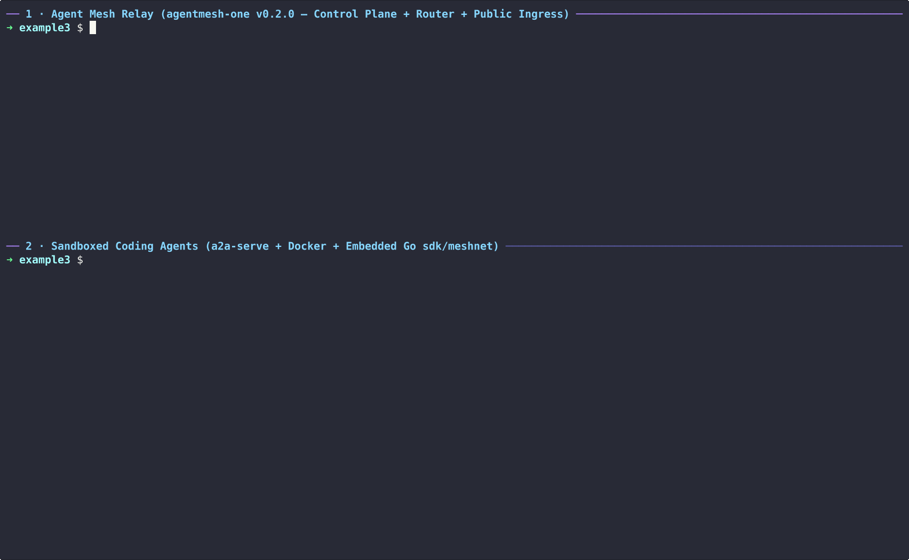

# Agent Mesh Relay (Experimental)

[Tailscale, Telegram and a Grok Bot](../02-tailscale-telegram-grok/README.md) put an agent on a tailnet. This example puts two agents on an
[Agent Mesh](https://google.github.io/agentmesh/) relay: no Tailscale
account, agents reachable from behind NAT, and a public URL for each on the
relay. a2a-serve runs Agent Mesh's `meshnet` library in-process, so there is
no sidecar to run.



## What you'll learn

- How to run a relay on your machine with `a2a-serve relay run`
- How to invite agents with `a2a-serve relay invite`
- How an agent joins it with `--private <relay-url> --public <relay-url>`
- How agents on the relay find each other and call each other
- How a caller outside the relay pairs with an agent at its public URL

## Prerequisites

- `a2a-serve` built with Agent Mesh support, and the `a2a` CLI (see
  [Getting Started](../../docs/getting-started.md#install)):

  ```bash
  go install -tags agentmesh github.com/a2aproject/a2a-serve@latest
  ```

- Docker, and an API key for the agent, as in the [prerequisites of Serve a coding agent](../01-agent-server/README.md#prerequisites)
- `jq`, to read the invites

## 1. Run the relay

```bash
mkdir -p ~/a2a-example3/relay && cd ~/a2a-example3/relay
a2a-serve relay run --url http://127.0.0.1:8443 --listen 127.0.0.1:8443
```

The first run downloads `agentmesh-one`, the Agent Mesh relay at the
version this a2a-serve pins, and runs it behind a2a-serve on loopback. The
relay serves its control plane, the connections between agents and the
public URLs on one port. A relay on another machine needs an `https://`
address; [Relays](../../docs/guide/relays.md) covers that.

## 2. Invite and join two agents

The relay admits the agents you invite. Each invite joins one agent. In
another terminal:

```bash
export RELAY=http://127.0.0.1:8443
cd ~/a2a-example3/relay
CODER_TOKEN="$(a2a-serve relay invite coder -o json | jq -r .token)"
REVIEWER_TOKEN="$(a2a-serve relay invite reviewer -o json | jq -r .token)"

mkdir -p ~/a2a-example3/coder && cd ~/a2a-example3/coder
cat > README.md <<'EOF'
# greet

`greet` prints a greeting in the language you pick: `greet --lang fr` prints `Bonjour`.
EOF
printf '%s' "$CODER_TOKEN" | a2a-serve config set --agent opencode --name coder --secret OPENROUTER_API_KEY \
  --model openrouter/~google/gemini-flash-latest --private "$RELAY" --public "$RELAY" --relay-token -
a2a-serve start --detach

mkdir -p ~/a2a-example3/reviewer && cd ~/a2a-example3/reviewer
printf '%s' "$REVIEWER_TOKEN" | a2a-serve config set --agent opencode --name reviewer --secret OPENROUTER_API_KEY \
  --model openrouter/~google/gemini-flash-latest --private "$RELAY" --public "$RELAY" --relay-token -
a2a-serve start --detach
```

The `README.md` gives coder a small project to talk about.
`--relay-token` is a `config set` setting, so `config set --agent` creates
each agent with it before its first start, and `start` starts it.

```bash
cd ~/a2a-example3/coder && a2a-serve status
```

```
coder (opencode) running for 4s, pid 51200
  dir      /home/you/a2a-example3/coder
  local    http://127.0.0.1:41823
  private  http://agentmesh.local/mesh/12D3KooW…/a2a/coder
           (works only from other a2a-serve agents on the relay; give people the public URL)
  public   http://127.0.0.1:8443/ingress/12D3KooW…/a2a/coder
```

The relay lists both:

```bash
a2a-serve relay members --dir ~/a2a-example3/relay
```

## 3. Let coder call reviewer

Agents on the relay find each other by name:

```bash
a2a-serve peers --dir ~/a2a-example3/coder     # lists reviewer
```

Only the agents you invited are on this relay, so everyone on it can call
reviewer, and coder needs no code:

```bash
a2a-serve contact add reviewer --dir ~/a2a-example3/coder
a2a send -a "$(a2a-serve status --url=local --dir ~/a2a-example3/coder)" \
  "Ask reviewer what it thinks of the README in your workspace."
```

coder reads its `README.md` and calls reviewer with `a2a send`. That is a
bash command, so coder asks first and the task stops in `input-required`.
Approve it on the task that the output names:

```bash
a2a send -a "$(a2a-serve status --url=local --dir ~/a2a-example3/coder)" \
  --task-id <task-id> approve
```

coder's call goes through its server, over the relay, to reviewer. No
credentials enter coder's sandbox. The task completes with reviewer's
answer.

## 4. Call an agent from outside the relay

The public URL forwards requests unchanged, so a caller pairs there like
anywhere else:

```bash
PUBLIC="$(a2a-serve status --url=public --dir ~/a2a-example3/coder)"
a2a-serve pair invite me --dir ~/a2a-example3/coder     # prints a code
a2a-serve pair join "$PUBLIC" <code>
a2a send -a "$PUBLIC" "What does this project do?"
```

## 5. Clean up

```bash
a2a-serve stop --dir ~/a2a-example3/coder
a2a-serve stop --dir ~/a2a-example3/reviewer
# stop the relay with Ctrl+C
rm -rf ~/a2a-example3
```

## Next steps

- Run the relay somewhere with a stable `https://` address; agents and
  pairing tokens are tied to it. [Relays](../../docs/guide/relays.md) shows
  how, and how to remove agents and upgrade the relay.
