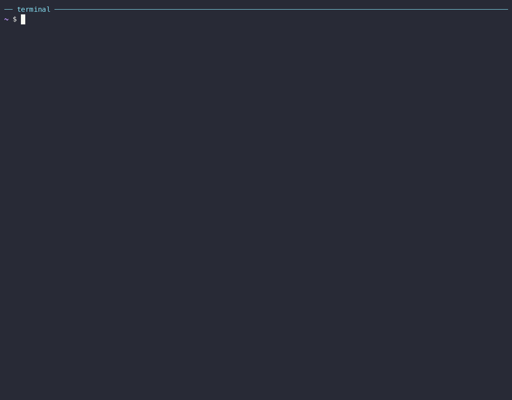

# Observability Agent

This example creates an agent from a recipe that answers questions about production and investigates incidents with your metrics, logs, traces and profiles.



## What you'll learn

- How to create an agent from a recipe, and leave out the connectors you don't have
- How to give the agent read-only identities
- How to describe your environment to the agent
- How to share the agent with your team, and update it to a newer version of its recipe

The recipe is in [`recipe/`](recipe/). It uses Grafana for every signal, and optionally your Kubernetes cluster and GitHub repositories.

## Prerequisites

- The `a2a` CLI and `a2a-serve` installed (see [Getting Started](../../docs/getting-started.md#install)), with Docker.
- An API key for the model, such as `OPENROUTER_API_KEY`, exported in your shell.
- Grafana 9 or later with datasources for your metrics, logs, traces or profiles. Without one, see [Try it on your machine](#try-it-on-your-machine).
- Optional: `kubectl` access to your cluster, and a GitHub account with access to your service repositories.

## 1. Create read-only identities

Anyone who can call the agent can make it read what its identities can read. Give it the access you would give its callers.

**Grafana.** In Grafana, open Administration, Users and access, Service accounts. Add a service account with the Viewer role, add a token to it, and export it with the URL of your Grafana:

```bash
export GRAFANA_URL=https://grafana.example.com
export GRAFANA_SERVICE_ACCOUNT_TOKEN=glsa_...
```

**Kubernetes (optional).** Create a ServiceAccount bound to the built-in `view` ClusterRole, which can't read Secrets, and write a kubeconfig for it to `~/.kube/a2a-o11y`:

```bash
kubectl create serviceaccount a2a-o11y -n default
kubectl create clusterrolebinding a2a-o11y-view --clusterrole=view --serviceaccount=default:a2a-o11y
TOKEN=$(kubectl create token a2a-o11y -n default --duration=720h)

mkdir -p ~/.kube/a2a-o11y
K="--kubeconfig $HOME/.kube/a2a-o11y/config"
kubectl config view --minify --raw -o jsonpath='{.clusters[0].cluster.certificate-authority-data}' | base64 -d > ~/.kube/a2a-o11y/ca.crt
kubectl config set-cluster o11y --server="$(kubectl config view --minify -o jsonpath='{.clusters[0].cluster.server}')" \
  --certificate-authority="$HOME/.kube/a2a-o11y/ca.crt" --embed-certs $K
kubectl config set-credentials a2a-o11y --token="$TOKEN" $K
kubectl config set-context o11y --cluster=o11y --user=a2a-o11y $K
kubectl config use-context o11y $K
rm ~/.kube/a2a-o11y/ca.crt

cat > ~/.kube/a2a-o11y/config.toml <<'EOF'
read_only = true
kubeconfig = "/kube/config"
EOF
```

The agent sees this directory at `/kube`, read-only. The cluster's API server must be reachable from the agent's container. The token expires after 30 days; create a new one and run `set-credentials` again before then.

**GitHub (optional).** Create a fine-grained personal access token with read-only access to Contents, Pull requests and Actions of your service repositories, and export it:

```bash
export GITHUB_TOKEN=github_pat_...
```

## 2. Create the agent

```bash
cd ~
a2a-serve recipe https://github.com/a2aproject/a2a-serve/tree/main/examples/04-observability-agent/recipe --name o11y
```

The command shows what the agent will run and asks before it creates it in `~/o11y`. It then offers the variables you exported, and asks whether to use github and kubernetes. Answer `n` for a connector you don't have. Kubernetes stays off without `~/.kube/a2a-o11y`.

To create the agent without questions, such as in a script, export the variables and add `--yes`. Optional connectors without their variables stay off:

```bash
a2a-serve recipe https://github.com/a2aproject/a2a-serve/tree/main/examples/04-observability-agent/recipe \
  --name o11y --yes --secret OPENROUTER_API_KEY --model openrouter/google/gemini-flash-latest
```

## 3. Describe your environment

The agent reads `ENVIRONMENT.md` before every investigation. Fill in `~/o11y/ENVIRONMENT.md` with your services, datasources, label conventions, dashboards and SLOs. Or start the agent and ask it to learn the environment:

```bash
cd ~/o11y
a2a-serve start --detach
a2a send --history 0 -a "$(a2a-serve status --url)" "Learn the environment."
```

It answers with a proposed `ENVIRONMENT.md`. Review it, then save it to the file. The agent can't edit its workspace.

## 4. Approvals

The agent runs its MCP tools, such as a Prometheus query, without asking. Each MCP server here is read-only on its own side: mcp-grafana runs with `--disable-write`, GitHub's endpoint is read-only, and the Kubernetes identity has the `view` role.

The recipe's approval rules cover the agent's own tools. It reads and searches its workspace without asking. It can't edit files, run commands or fetch URLs: such a call is denied, and the agent answers another way. Approving single MCP tools is planned.

## 5. Share it with your team

Make the agent reachable on your tailnet and from Telegram:

```bash
a2a-serve config set --private tailscale --restart
a2a-serve channel add telegram --token env:TELEGRAM_BOT_TOKEN
```

Optionally, send a digest every weekday morning:

```bash
a2a-serve schedule add morning-digest --cron "0 9 * * 1-5" \
  --prompt "Summarize the alerts and anomalies since 18:00 yesterday." --chat telegram:owner
```

## 6. Ask it

```bash
a2a send --history 0 -a "$(a2a-serve status --url)" "Why is checkout slow since 14:00?"
a2a send --history 0 -a "$(a2a-serve status --url)" "Which services return the most errors this hour?"
a2a send --history 0 -a "$(a2a-serve status --url)" "Did yesterday's deploy change the memory use of api?"
```

Each answer starts with the conclusion, followed by the queries, time ranges and Grafana links behind it.

## 7. Update it

When the recipe changes, update the agent from its directory:

```bash
cd ~/o11y
a2a-serve recipe
```

The update keeps your changes. Your `ENVIRONMENT.md` stays, and a changed template arrives next to it as `ENVIRONMENT.md.recipe`. See [Recipes](../../docs/guide/recipes.md#update-an-agent).

## Try it on your machine

Without a Grafana of your own, run `grafana/otel-lgtm`, which bundles Grafana with Prometheus, Loki, Tempo and Pyroscope:

```bash
docker run -d --name lgtm -p 3000:3000 -p 4317:4317 -p 4318:4318 grafana/otel-lgtm
```

Create a Viewer service account and a token with Grafana's API. The image's admin login is `admin`, password `admin`:

```bash
SA=$(curl -s -u admin:admin -H 'Content-Type: application/json' \
  -d '{"name":"a2a-o11y","role":"Viewer"}' http://localhost:3000/api/serviceaccounts | jq .id)
export GRAFANA_SERVICE_ACCOUNT_TOKEN=$(curl -s -u admin:admin -H 'Content-Type: application/json' \
  -d '{"name":"a2a-o11y"}' "http://localhost:3000/api/serviceaccounts/$SA/tokens" | jq -r .key)
export GRAFANA_URL=http://host.docker.internal:3000
```

The agent's container reaches your machine at `host.docker.internal`. Create the agent as in step 2, and answer `n` for github and kubernetes. The stack has data once an app sends it OpenTelemetry on port 4317 or 4318.

Clean up with `a2a-serve stop` in `~/o11y` and `docker rm -f lgtm`.
