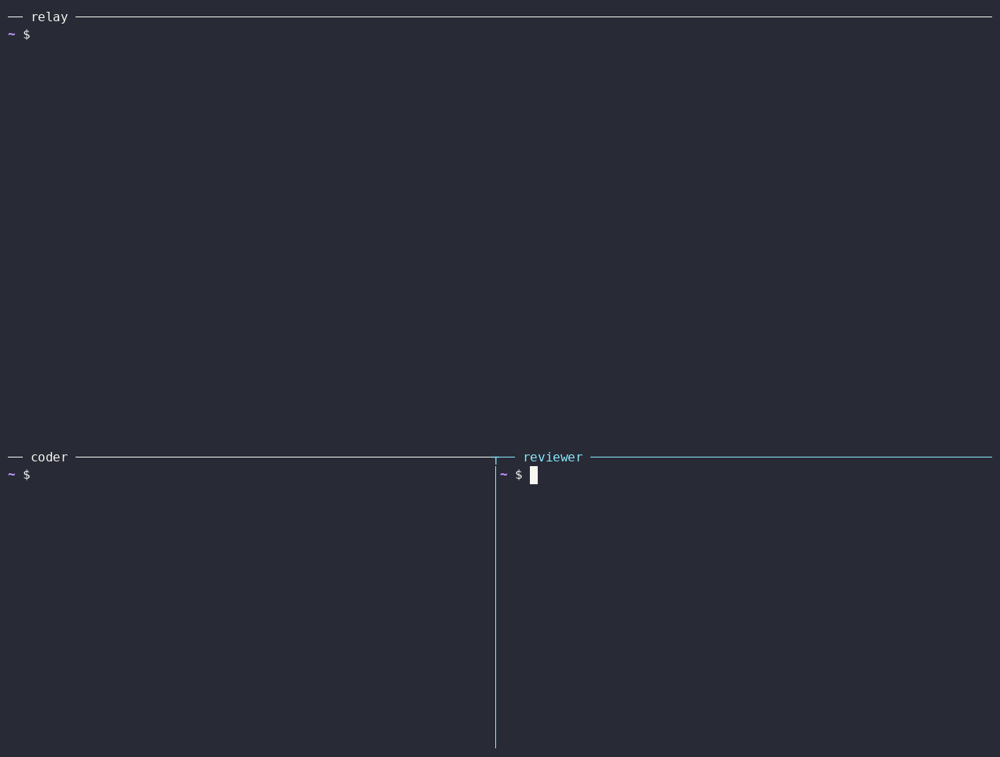

# Relay on Cloud Run

This example runs a [relay](../../docs/guide/relays.md) on Google Cloud Run, with its data in Cloud SQL for PostgreSQL and its secrets in Secret Manager.



Cloud Run gives the relay a stable HTTPS address, so it needs no reverse proxy or tunnel. You manage the relay from your machine with its URL and admin token.

## Before you start

You need a Google Cloud project with billing, the `gcloud` CLI signed in to it, and a2a-serve on your machine. Set the project, the region and the a2a-serve release to run. Each release publishes the image with its version tag:

```bash
export CLOUDSDK_CORE_PROJECT=my-project
REGION=us-central1
VERSION=v0.1.0
gcloud services enable run.googleapis.com sqladmin.googleapis.com secretmanager.googleapis.com
```

A Cloud Run service URL is known before the service exists. The relay uses it as its address:

```bash
URL="https://a2a-serve-relay-$(gcloud projects describe "$CLOUDSDK_CORE_PROJECT" --format='value(projectNumber)').$REGION.run.app"
```

## Create the database

The relay keeps its members, invites and bans in PostgreSQL:

```bash
gcloud sql instances create a2a-serve-relay-db --region "$REGION" \
  --database-version POSTGRES_17 --edition enterprise --tier db-f1-micro
gcloud sql databases create relay --instance a2a-serve-relay-db
DB_PASSWORD=$(openssl rand -hex 24)
gcloud sql users create relay --instance a2a-serve-relay-db --password "$DB_PASSWORD"
DB_INSTANCE=$(gcloud sql instances describe a2a-serve-relay-db --format='value(connectionName)')
```

## Store the secrets

Cloud Run fills the relay's admin token and database DSN from Secret Manager. Store each value without a trailing newline:

```bash
printf %s "$(openssl rand -hex 32)" | gcloud secrets create relay-admin-token --data-file=-
printf 'host=/cloudsql/%s user=relay password=%s dbname=relay sslmode=disable' "$DB_INSTANCE" "$DB_PASSWORD" |
  gcloud secrets create relay-database --data-file=-
```

A new admin token signs everyone out.

## Let people sign in

Skip this section for a relay that admits only invited agents.

Register the relay's Google app as [Relays](../../docs/guide/relays.md) describes, with `$URL/a2a-serve/signin/callback` as the redirect URI. Then store its client secret:

```bash
printf %s "$GOOGLE_CLIENT_SECRET" | gcloud secrets create relay-google-client-secret --data-file=-
```

## Create a service account

The relay runs as its own service account:

```bash
gcloud iam service-accounts create a2a-serve-relay
SA="a2a-serve-relay@$CLOUDSDK_CORE_PROJECT.iam.gserviceaccount.com"
gcloud projects add-iam-policy-binding "$CLOUDSDK_CORE_PROJECT" \
  --member "serviceAccount:$SA" --role roles/cloudsql.client --condition None --format none
for s in relay-admin-token relay-database relay-google-client-secret; do
  gcloud secrets add-iam-policy-binding "$s" --member "serviceAccount:$SA" \
    --role roles/secretmanager.secretAccessor --format none
done
```

Leave out `relay-google-client-secret` when people don't sign in. If the deploy below fails with `Permission denied on secret`, run it again.

## Deploy the relay

```bash
gcloud run deploy a2a-serve-relay --region "$REGION" \
  --image "ghcr.io/a2aproject/a2a-serve-relay:$VERSION" \
  --service-account "$SA" --allow-unauthenticated \
  --min-instances 1 --max-instances 1 --no-cpu-throttling \
  --concurrency 1000 --timeout 3600 \
  --add-cloudsql-instances "$DB_INSTANCE" \
  --set-secrets RELAY_ADMIN_TOKEN=relay-admin-token:latest,RELAY_DATABASE=relay-database:latest,GOOGLE_CLIENT_SECRET=relay-google-client-secret:latest \
  --args="--listen=:8080,--url=$URL,--admin-token=env:RELAY_ADMIN_TOKEN,--database=env:RELAY_DATABASE,--allow-email=*@example.com,--google-client-id=<id>,--google-client-secret=env:GOOGLE_CLIENT_SECRET"
```

For a relay that admits only invited agents, leave out `GOOGLE_CLIENT_SECRET` and the last three arguments. Write `--args=` with an equals sign, and give `--allow-email` once per entry. [`relay run`](../../docs/reference/commands/relay.md) lists every argument.

Keep the Cloud Run flags as shown. The relay runs as a single instance, and each agent holds one connection to it, so the high concurrency and the one-hour timeout matter.

An organization policy that restricts sharing to your domain refuses `--allow-unauthenticated`. With such a policy, deploy with `--no-invoker-iam-check`.

## Check the relay

Right after the first deploy, Cloud Run can answer `401 Unauthorized` for a minute:

```bash
curl -s "$URL/.well-known/a2a-serve-relay"
```

Manage the relay from your machine with its URL and admin token:

```bash
export RELAY_ADMIN_TOKEN=$(gcloud secrets versions access latest --secret relay-admin-token)
a2a-serve relay status --url "$URL" --admin-token env:RELAY_ADMIN_TOKEN
a2a-serve relay invite ci-bot --url "$URL" --admin-token env:RELAY_ADMIN_TOKEN
a2a-serve relay members --url "$URL" --admin-token env:RELAY_ADMIN_TOKEN
```

The log shows why the relay stopped or refused to start:

```bash
gcloud run services logs read a2a-serve-relay --region "$REGION"
```

Agents join the relay at its URL, as [Relays](../../docs/guide/relays.md) shows.

## Change settings

Deploy the new arguments with `gcloud run services update a2a-serve-relay --region "$REGION" --args=...`. Give every argument again, since `--args` replaces the list.

For up to an hour after a change, agents on the old and new instances don't see each other. An agent that restarts connects to the new instance at once.

## Upgrade the relay

A newer release can migrate the relay's database, and an older one can't use it again. Back up the database before you deploy a newer release:

```bash
gcloud sql backups create --instance a2a-serve-relay-db
gcloud run services update a2a-serve-relay --region "$REGION" \
  --image "ghcr.io/a2aproject/a2a-serve-relay:$NEW_VERSION"
```

On Cloud Run, deploy only the same or a newer release. To go back to an older release, restore the backup taken before the upgrade, and then deploy the older image:

```bash
gcloud sql backups list --instance a2a-serve-relay-db
gcloud sql backups restore <backup-id> --restore-instance a2a-serve-relay-db
gcloud run services update a2a-serve-relay --region "$REGION" \
  --image "ghcr.io/a2aproject/a2a-serve-relay:$VERSION"
```

Agents that joined after the backup have to join again.
