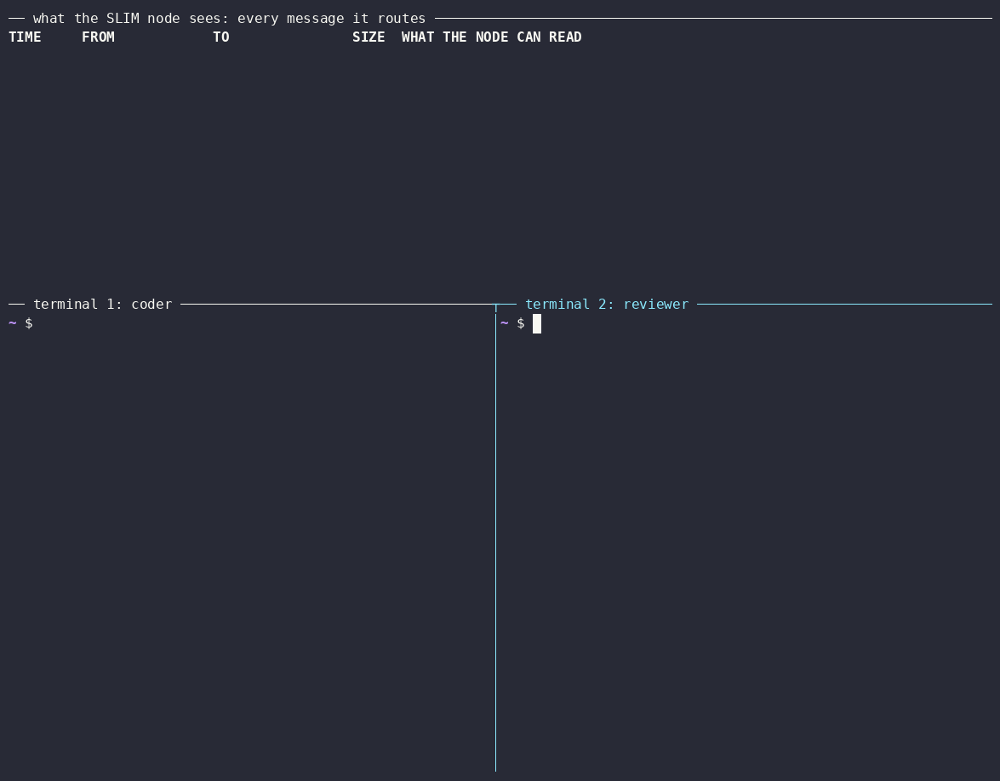

# SLIM Network (Experimental)

[Agent Mesh Relay](../03-agentmesh-relay/README.md) puts two agents on a relay. This example puts two agents on a [SLIM](https://docs.agntcy.org/slim/overview/) node with the SLIM network provider. The agents call each other over SLIMRPC, and a SLIM client that knows nothing about a2a-serve calls an agent by its SLIM name.



## What you'll learn

- How to run a SLIM node in Docker
- How an agent joins it with `--private <node-url> --network-provider slim`
- How agents on the node find each other and call each other
- How any SLIM A2A client calls an agent by its SLIM name

## Prerequisites

- `a2a-serve` and the `a2a` CLI (see [Getting Started](../../docs/getting-started.md#install))
- Docker, and an API key for the agent, as in the [prerequisites of Serve a coding agent](../01-agent-server/README.md#prerequisites)
- Go and a C compiler, to build the SLIM network provider, which has no release yet
- `openssl`, to make the node's shared secret

## 1. Run the SLIM node

```bash
git clone https://github.com/a2aproject/a2a-serve ~/a2a-example7/a2a-serve
cd ~/a2a-example7/a2a-serve/examples/07-slim-network
docker compose up -d --wait
```

The node listens on `127.0.0.1:46357` without TLS. It plays the part of a relay: agents behind NAT reach each other through it.

## 2. Build the SLIM network provider

The provider links the SLIM library with cgo. Build it next to `a2a-serve`, where the server finds it, and build the SLIM client of step 5:

```bash
cd ~/a2a-example7/a2a-serve/providers/slim
go run github.com/agntcy/slim-bindings-go/v3/cmd/slim-bindings-setup
go build -o "$(dirname "$(command -v a2a-serve)")/netprovider-slim" .
go build -o ~/a2a-example7/slim-a2a-send ./cmd/slim-a2a-send
```

## 3. Join two agents

The agents share a secret, which proves to the node that they belong together, and list each other as peers, since SLIM has no directory:

```bash
export SLIM='http://127.0.0.1:46357?namespace=example7&peers=coder,reviewer'
export SLIM_SECRET="$(openssl rand -hex 32)"

mkdir -p ~/a2a-example7/coder && cd ~/a2a-example7/coder
cat > README.md <<'EOF'
# greet

`greet` prints a greeting in the language you pick: `greet --lang fr` prints `Bonjour`.
EOF
printf '%s' "$SLIM_SECRET" | a2a-serve config set --agent opencode --name coder --secret OPENROUTER_API_KEY \
  --model openrouter/~google/gemini-flash-latest --private "$SLIM" --network-provider slim --network-token -
a2a-serve start --detach

mkdir -p ~/a2a-example7/reviewer && cd ~/a2a-example7/reviewer
printf '%s' "$SLIM_SECRET" | a2a-serve config set --agent opencode --name reviewer --secret OPENROUTER_API_KEY \
  --model openrouter/~google/gemini-flash-latest --private "$SLIM" --network-provider slim --network-token -
a2a-serve start --detach
```

```bash
cd ~/a2a-example7/coder && a2a-serve status
```

```
coder (opencode) running for 4s, pid 51200
  dir      /home/you/a2a-example7/coder
  local    http://127.0.0.1:41823
  private  http://slim.local/a2a/example7/coder
           (works only from other agents on the SLIM node)
```

The agent's SLIM name is `a2a/example7/coder`: the org, the namespace and its name.

## 4. Let coder call reviewer

```bash
a2a-serve peers --dir ~/a2a-example7/coder     # lists reviewer
a2a-serve contact add reviewer --dir ~/a2a-example7/coder
a2a send -a "$(a2a-serve status --url=local --dir ~/a2a-example7/coder)" \
  "Ask reviewer what it thinks of the README in your workspace."
```

coder calls reviewer with `a2a send`, a bash command, so it asks first and the task stops in `input-required`. Approve it on the task that the output names:

```bash
a2a send -a "$(a2a-serve status --url=local --dir ~/a2a-example7/coder)" \
  --task-id <task-id> once
```

The call travels over SLIMRPC through the node, and reviewer sees it come from `a2a/example7/coder`.

## 5. Call an agent from a SLIM client

`slim-a2a-send` is a plain SLIM A2A client. It joins the node with the same secret and calls reviewer by its SLIM name:

```bash
~/a2a-example7/slim-a2a-send a2a/example7/reviewer "What does a good README start with?"
```

```
→ reviewer (a2a/example7/reviewer)
A one-line summary of what the project does.
✓ task COMPLETED
```

reviewer sees the call come from `a2a/example7/slim-a2a-send`, a member of the private network.

## 6. Clean up

```bash
a2a-serve stop --dir ~/a2a-example7/coder
a2a-serve stop --dir ~/a2a-example7/reviewer
(cd ~/a2a-example7/a2a-serve/examples/07-slim-network && docker compose down)
rm -rf ~/a2a-example7
```

## Next steps

- Anyone with the shared secret can claim any name on the node. Keep the node on your own machines, as [SLIM nodes](../../docs/guide/networks.md#slim-nodes-experimental) explains.
- [Network provider protocol](../../docs/reference/network-providers.md) shows how to put agents on another network.
