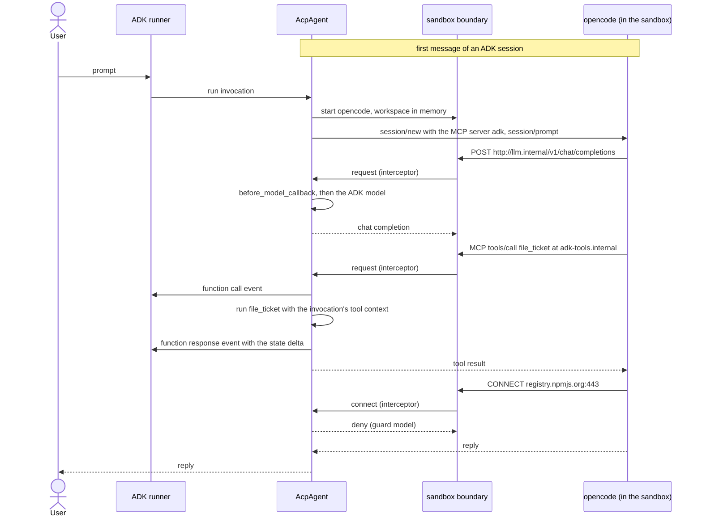

# A coding agent in a sandbox, as an ADK agent

This sample runs `opencode acp` as an ADK agent written in Python, with an ADK model as opencode's model. Every ADK session gets its own Docker container, whose `/workspace` lives in memory, and whose network is only what [`agent.py`](agent.py) allows. It is the Python counterpart of the [acpagent sample of adk-go](https://github.com/google/adk-go/pull/2021).

The whole agent is one `AcpAgent`:

```python
root_agent = AcpAgent(
    name="sandboxed_coder",
    model="gemini-2.5-flash",
    before_model_callback=model_budget,
    sandbox=SandboxConfig(image=IMAGE, command=["opencode", "acp"], files=WORKSPACE, env=OPENCODE_ENV, egress=GuardEgress()),
    allow_tools=["*"],
    tools=[FunctionTool(file_ticket)],
)
```

- **The workspace lives in memory.** The container mounts a tmpfs at `/workspace`, seeded from a dict in `agent.py`. What the agent writes there never reaches the host's disk. Python reads the files back when the run ends. The rest of the container, such as opencode's own state in its home, is Docker's usual writable layer.
- **opencode's model is the agent's ADK model.** opencode's only provider is `http://llm.internal/v1`. AcpAgent answers its requests by turning each into an ADK `LlmRequest` for `model`, here Gemini on Vertex AI with the host's credentials. The container never holds a credential. `before_model_callback` counts the calls in the session state and refuses them past a budget, as it would for an `LlmAgent`.
- **ADK tools reach the agent over MCP.** `http://adk-tools.internal/mcp` is answered in process by `AcpAgent.handle_mcp`. `file_ticket` runs in the ADK invocation, and its call, response and state change are events of the session.
- **A guard model decides the rest.** `SandboxConfig.egress` gets every other connection, or plain HTTP request, and asks Gemini, which answers allow or deny.

## How it works



## Compared with adk-go's acpagent

`a2a_serve.adk.AcpAgent` follows the `exp/acpagent` package of adk-go:

| acpagent (Go) | AcpAgent (Python) |
|---|---|
| `Command`, `Dir`, `Env`, or `Start` for a harness in a sandbox | `argv`, or `start`, which returns the descriptor of the harness's stdio, here from a `Sandbox` |
| Each ADK session maps to its own ACP session; the harness gets only the messages it hasn't seen | The same: an ACP session per ADK session, and the messages of others since the agent's last turn, marked with their author |
| `AllowTools`, `DenyTools` answer permission requests by ACP tool kind | `allow_tools`, `deny_tools` |
| Other questions end the invocation, and the user's next message answers them | The same; the question is the invocation's last event, with `acp_input_required` in its metadata |
| `Tools` served over MCP on a loopback port; calls and responses are events of the invocation | `tools` served over MCP at `mcp_url`, which the sandbox's interceptor answers in process, so nothing listens on the host; calls and responses are events of the invocation |
| An abandoned run cancels the harness's work | The same, also when the run ends before its first event |
| One harness process for every session | One per ADK session, so that each session gets its own sandbox; it stops when idle and starts again on the next message |
| The harness uses its own model | `model` makes an ADK model the harness's model, with the model callbacks; the harness's own provider config is replaced by `model_url` |

The tests in [`python/tests/test_adk_agent.py`](../../tests/test_adk_agent.py) follow those of acpagent: conversation, permissions, answers in a later invocation, tools, tools after an abandoned run, tools per session, and the config checks.

## Requirements

- Linux with Docker and `/dev/net/tun`.
- Application default credentials for a Google Cloud project with Vertex AI: `gcloud auth application-default login`. `GOOGLE_CLOUD_PROJECT` picks another project than the credentials' own.
- The libraries and the package: `clib/build.sh`, then `pip install -e 'python[adk]'`.

## Run

```sh
cd python/samples/adk_sandbox_coder
python main.py
```

| Variable | Default | Meaning |
|---|---|---|
| `ACP_IMAGE` | `ghcr.io/a2aproject/harness-opencode:latest` | The image of the containers |
| `ACP_COMMAND` | `opencode acp` | The agent's command |
| `MODEL` | `gemini-2.5-flash` | The ADK model behind `llm.internal` |
| `GUARD_MODEL` | `gemini-2.5-flash` | The model that decides other traffic |
| `MAX_MODEL_CALLS` | `60` | The budget of model calls per session, which `before_model_callback` keeps |
| `MAX_GUARD_CALLS` | `40` | The budget of guard-model questions per session; past it, other traffic is denied |
| `SANDBOX_IDLE` | `1800` | Seconds without traffic or a turn in progress after which a session's sandbox and workspace are removed. It is at least a minute longer than the 10 minutes after which the agent stops. |
| `SANDBOX_LOG` | unset | `1` prints each decision as it happens |

`adk web` and `adk run` load the agent from `agent.py` as `root_agent` too.

## Example run

Real output, trimmed. The model decides what it does, so your output will differ.

```text
$ python main.py
User -> Run the tests with `python3 -m unittest -q`, fix the bugs in stats.py until they pass, then file one ticket with file_ticket for a missing test you would add. Reply with a one-paragraph summary and the ticket ID.

[agent tool] python3 -m unittest -q (completed)
[agent tool] workspace/stats.py (completed)
[agent tool] workspace/stats.py (completed)
[agent tool] python3 -m unittest -q (completed)
[agent tool] adk_file_ticket (in_progress)
[adk tool call] file_ticket({'body': 'The median function in stats.py needs a test case for an input list with an odd number of elements to ensure correctness.', 'title': 'Add test for median function with odd number of elements'})
[adk tool result] {'id': 'T-1'}
[agent tool] adk_file_ticket (completed)
Agent -> I ran the existing tests, fixed the bugs in `stats.py` related to `mean` and `median` calculations, and re-ran the tests to confirm the fixes. [...] I also filed a ticket (ID: T-1) for a missing test case for the `median` function, specifically for lists with an odd number of elements.

Workspace in memory:
  __pycache__/stats.cpython-313.pyc
  __pycache__/test_stats.cpython-313.pyc
  stats.py
  test_stats.py

Tests in the sandbox: exit 0
Ran 2 tests in 0.000s

OK

Tickets in the session state: [{'id': 'T-1', 'title': 'Add test_median_odd to test_stats.py', 'body': '...'}]
Model calls in the session state: 8

Guard log:
  connect registry.npmjs.org:443 -> deny (guard model)
```

The 8 model calls went through ADK's Gemini model, and `model_budget` counted them in the session state. opencode tried to reach the npm registry while it edited, and the guard model refused, which didn't stop the run.

## Notes

- **One container per ADK session.** opencode stops after 10 idle minutes and starts again in the same container on the next message, so the workspace survives. After `SANDBOX_IDLE`, the sandbox and its workspace are removed, and the next message starts in a fresh one. Closing the agent removes them all.
- **Tool callbacks, plugins and confirmation don't apply** to the tools that the coding agent calls, as in adk-go.
- **HTTPS to other hosts isn't inspected.** The guard model sees only the host and port. List hosts in the sandbox's `inspect_tls` to see their requests too, for clients that trust the sandbox's CA.
